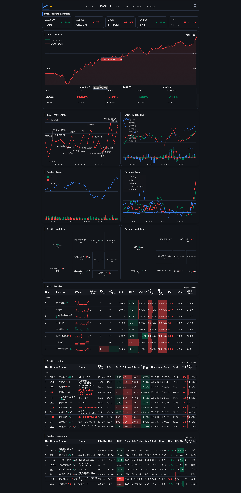
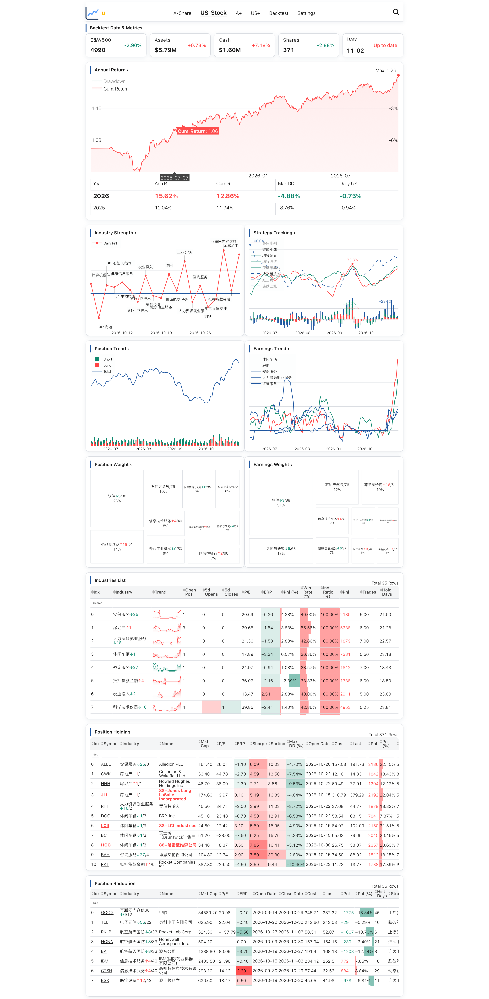
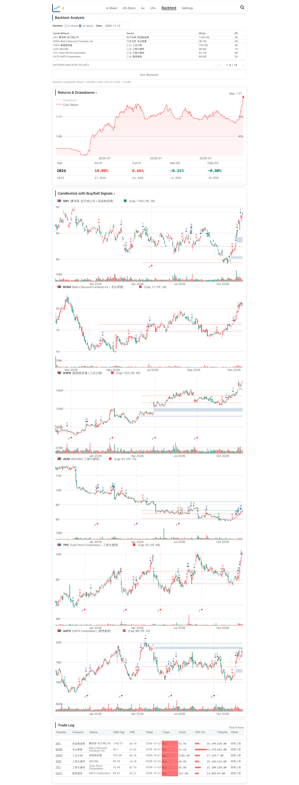
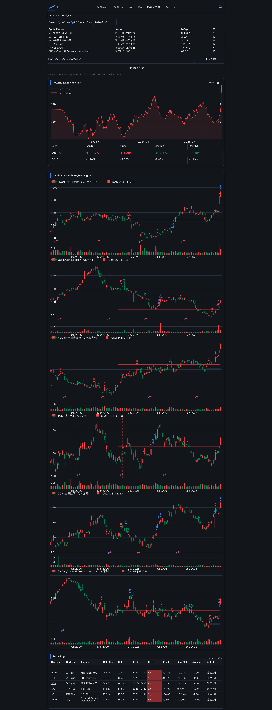
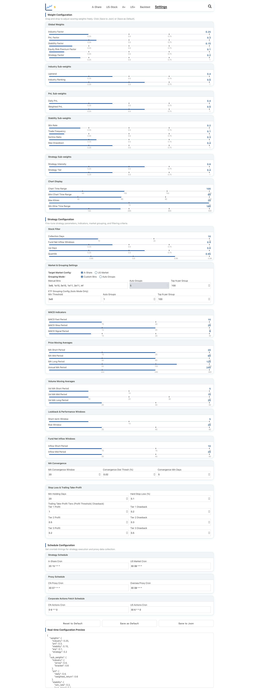
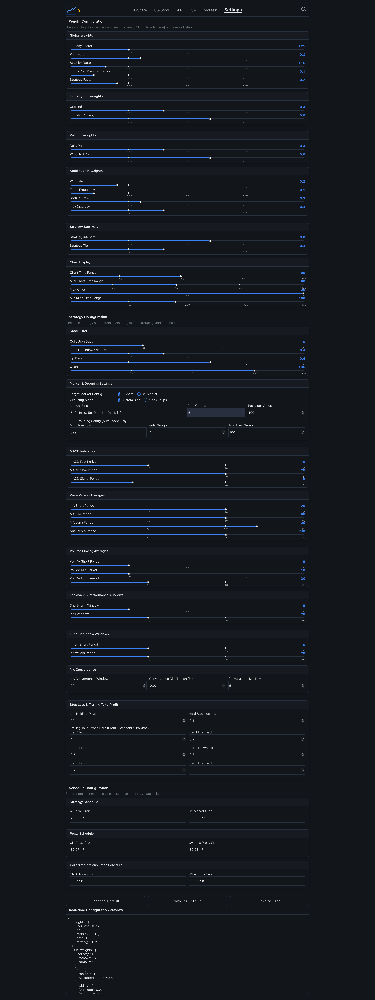

# OpenQuantLab

**An open-source quantitative research and portfolio analytics toolkit for China A-shares and US equities.**

[简体中文](#简体中文) · [Features](#features) · [Screenshots](#screenshots) · [Quick start](#quick-start)

[](https://github.com/joeyrensh/pub_finance/stargazers)
[](https://github.com/joeyrensh/pub_finance/forks)
[](https://www.python.org/)
[](https://dash.plotly.com/)

OpenQuantLab brings market-data workflows, Backtrader strategy runs, and interactive Dash reports into one Python project. Explore A-share and US equity data, review strategy performance, and inspect signals in charts and tables.

> **Project name:** OpenQuantLab · **Repository:** [`joeyrensh/pub_finance`](https://github.com/joeyrensh/pub_finance)

## Features

- **A-share and US equity workflows** — market-data collection, local datasets, and scheduled update scripts.
- **Configurable research factors** — adjust scoring weights, grouping settings, and technical indicator parameters.
- **Backtrader strategy analysis** — run backtests and review cumulative returns, drawdowns, annual metrics, and trade records.
- **Interactive Dash reports** — explore market summaries, sector strength, strategy signals, holdings, and searchable tables.
- **Light and dark themes** — the dashboard adapts to the selected appearance.
- **Optional AI summaries** — request stock summaries when an LLM provider is configured.

## Screenshots

The screenshots below show the dashboard in dark theme. The application also supports light theme.
The dashboard supports both light and dark themes. Each page below is shown in both modes.


### Dashboard

<details>
<summary>More views: dashboard</summary>
<p align="center">
  
  
</p>

### Backtest
<summary>More views: Backtest page with return and drawdown analysis</summary>
<p align="center">
  
  
</p>

### Settings
<summary>More views: Settings page with configurable scoring weights</summary>
<p align="center">
  
  
</p>

</details>

## Data and analysis flow

```text
Market data sources
        ↓
Local data files and update jobs
        ↓
Backtrader strategy runs
        ↓
Interactive Dash reports
```

## Quick start

### Requirements

- Python 3
- Git

### Install and launch the local dashboard

```bash
git clone https://github.com/joeyrensh/pub_finance.git
cd pub_finance/openquantlab

python3 -m venv .venv
source .venv/bin/activate       # Windows: .venv\Scripts\activate
python -m pip install --upgrade pip
python -m pip install -r finance/requirements.txt

python -m finance.dashreport.backtest_app
```

Open <http://127.0.0.1:8050/dash-financial-report/a-share>. The dashboard reads the local datasets under `finance/`; run the relevant data collection or update scripts if your local data has not been initialized. Login credentials are managed by the dashboard configuration.

## Repository layout

```text
openquantlab/finance/
├── dashreport/       # Dash application, pages, callbacks, and charts
├── backtraderref/    # Backtrader strategy components
├── cncrawler/        # A-share data collection
├── uscrawler/        # US market data collection
├── cnstockinfo/      # A-share data workflows
├── usstockinfo/      # US market data workflows
├── utility/          # Shared utilities and data tools
├── cnstock_main.py   # A-share workflow entry point
└── usstock_main.py   # US workflow entry point
```

## Contributing

Issues, ideas, and pull requests are welcome. Please open an issue to discuss a larger change before submitting it.

## Disclaimer

This project is for research and educational use. It is not investment advice, and backtest results do not guarantee future performance.

---

## 简体中文

**面向 A 股与美股的开源量化研究和组合分析工具。**

OpenQuantLab 将行情数据处理、Backtrader 策略回测与 Dash 交互式报表整合在一个 Python 项目中，便于浏览市场数据、评估策略表现和查看交易信号。

### 功能特点

- **A 股与美股数据流程**：行情采集、本地数据集及定时更新脚本。
- **可配置的研究因子**：调整评分权重、分组设置和技术指标参数。
- **Backtrader 策略分析**：执行回测，查看累计收益、回撤、年度指标和交易记录。
- **交互式 Dash 报表**：查看市场摘要、行业强弱、策略信号、持仓及可筛选表格。
- **浅色和深色主题**：页面适配所选主题。
- **可选 AI 摘要**：配置 LLM 服务后可请求个股摘要。

### 界面截图

仓库现有截图为深色主题；应用同时支持浅色主题。
上方英文版截图区展示了仪表盘、回测和设置页面在浅色与深色主题下的效果。


<details>
<summary>更多界面：仪表板</summary>
<p align="center">
  
  
</p>

#### 回测
<summary>更多界面：回测页面：收益与回撤分析</summary>
<p align="center">
  
  
</p>

#### 设置
<summary>更多界面：设置页面：可配置评分权重</summary>
<p align="center">
  
  
</p>

</details>

### 快速开始

```bash
git clone https://github.com/joeyrensh/pub_finance.git
cd pub_finance/openquantlab

python3 -m venv .venv
source .venv/bin/activate       # Windows: .venv\Scripts\activate
python -m pip install --upgrade pip
python -m pip install -r finance/requirements.txt

python -m finance.dashreport.backtest_app
```

浏览器打开 <http://127.0.0.1:8050/dash-financial-report/a-share>。Dash 页面读取 `finance/` 下的本地数据；首次使用前，请运行对应的数据采集或更新脚本。登录凭证由应用配置管理。

### 项目结构

```text
openquantlab/finance/
├── dashreport/       # Dash 应用、页面、回调和图表
├── backtraderref/    # Backtrader 策略组件
├── cncrawler/        # A 股数据采集
├── uscrawler/        # 美股数据采集
├── cnstockinfo/      # A 股数据流程
├── usstockinfo/      # 美股数据流程
├── utility/          # 通用工具和数据脚本
├── cnstock_main.py   # A 股流程入口
└── usstock_main.py   # 美股流程入口
```

欢迎通过 Issues 反馈问题、提出想法或提交 Pull Request。较大的改动建议先开 Issue 讨论。

> 本项目仅供研究和学习使用，不构成投资建议。历史回测结果不代表未来表现。

---

If OpenQuantLab is useful to you, consider starring the repository.